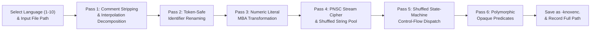

# 🛡️ KNOXENC (UOBF v2.0) — Termux Multi-Language Source Encoder & Obfuscator

[](#)
[](#-termux-quick-start-git-commands)
[](#)
[-orange?style=flat-square)](#)
[](#)

**KnoxEnc (`knoxenc` / `uobf`)** is a zero-dependency, polymorphic multi-language source code encoder and obfuscator built specifically for **Termux (Android)** and **Linux CLI** workflows.

When launched inside Termux, it interactively prompts you for:
1. **Which language you need to encode** (`Python`, `JavaScript`, `Bash`, `C`, `C++`, `Java`, `Rust`, `Ruby`, `HTML`, `CSS`)
2. **The path of the file to encode** (supports `/sdcard/...`, `~/storage/shared/...`, or any local path)
3. Automatically encodes the file using a multi-round cryptographic stream cipher + Mixed Boolean-Arithmetic (MBA), saves the encoded file as **`<filename>-knoxenc.<extension>`**, records the path in `encoded-paths.txt`, and prints the full saved path.

---

## 📱 Termux Quick Start (Git Commands)

Open **Termux** on Android and run these exact commands:

```bash
# 1. Update packages and install Node.js + Git
pkg update -y && pkg upgrade -y
pkg install -y nodejs git

# 2. Allow Termux to access your phone storage (/sdcard) if encoding files in Download/Documents
termux-setup-storage

# 3. Clone the repository and enter the directory
git clone https://github.com/Knox-knx/universal-obfuscator.git
cd universal-obfuscator

# 4. (Optional) Install 'knoxenc' & 'uobf' globally into Termux $PREFIX/bin
chmod +x install.sh && ./install.sh

# 5. Run the interactive encoder!
node knoxenc.js
```

*(If you ran `./install.sh`, you can also simply type `knoxenc` from anywhere in Termux!)*

---

## 🖥️ Interactive Termux Workflow Preview

When you run `node knoxenc.js` (or `knoxenc`), it walks you through encoding step by step:

```text
╭──────────────────────────────────────────────────────────╮
│  KNOXENC / UOBF v2.0.0 — Universal Source Encoder       │
│  PNSC Stream Cipher • MBA Math • State-Machine Dispatch  │
╰──────────────────────────────────────────────────────────╯ [Termux Edition]

Select Language to Encode:
  [ 1] Python               (.py)
  [ 2] JavaScript / Node.js (.js)
  [ 3] Bash / Shell         (.sh)
  [ 4] C                    (.c)
  [ 5] C++                  (.cpp)
  [ 6] Java                 (.java)
  [ 7] Rust                 (.rs)
  [ 8] Ruby                 (.rb)
  [ 9] HTML                 (.html)
  [10] CSS                  (.css)

? Which language do you need to encode? (1-10 or name): 1
  ✓ Selected Language: Python (.py)

? Enter the path of the file to encode: /sdcard/Download/bot.py

╭──────────────────────────────────────────────────────────╮
│  ✓ FILE ENCODED SUCCESSFULLY                             │
╰──────────────────────────────────────────────────────────╯
  Language     : Python (.py)
  Input Path   : /sdcard/Download/bot.py
  Output File  : bot-knoxenc.py
  Saved Path   : /sdcard/Download/bot-knoxenc.py
  Path Saved In: /data/data/com.termux/files/home/universal-obfuscator/encoded-paths.txt
  Size & Stats : 151B -> 1632B (10.81x) | Entropy: 4.243 -> 4.492 bits/byte
```

- **Output Naming Format**: Every file `<filename>.<extension>` is automatically saved in the same folder as **`<filename>-knoxenc.<extension>`** (for example: `bot.py` $\rightarrow$ `bot-knoxenc.py`, `app.js` $\rightarrow$ `app-knoxenc.js`, `tool.sh` $\rightarrow$ `tool-knoxenc.sh`).
- **Saved Path History**: Every encoded file's full path and timestamp are also saved in `encoded-paths.txt` inside the project folder so you never lose track of where encoded files were written.

---

## ✨ Key Highlights

- 🔐 **Polymorphic Nibble-Stream Cipher (PNSC)**: Replaces trivial Base64/single-byte XOR with a 3-round stream cipher (**LCG rolling state + bit-rotation + modular addition + CBC/autokey ciphertext feedback**) encoded via keyed nibble-pair substitution. **No Base64 alphabet string or `base64` library import ever appears in the output or compiled binary.**
- 🧮 **Mixed Boolean-Arithmetic (MBA) Engine**: Disguises cipher keys, pool indices, state-machine transitions, and integer constants as nested bitwise-arithmetic identities (`(a | b) - (a & b)`, `(a ^ b) + ((a & b) << 1)`).
- 🔀 **Shuffled State-Machine Control-Flow Flattening**: Rewrites contiguous statement runs into `while`/`switch` (or `match` in Rust) state machines using randomly permuted 16-bit state IDs and MBA state transitions.
- 🧩 **6 Number-Theoretic Opaque-Predicate Families**: Injects mathematically proven tautologies and unreachable decoy `else` branches (consecutive integer parity, quadratic residues $\bmod 4$, odd squares $\bmod 8$, and MBA identities).
- 🎭 **4 Configurable Identifier Styles**: Choose between `hex` (`_0x4f8a1c`), visual `homoglyph` (`lI1O01lI1O`), `underscore` (`___a_b__f`), and `compact` (`_8f3a1`).

---

## 🏗️ Obfuscation Architecture



---

## 🚀 Direct CLI Flags (Optional Batch / Advanced Mode)

In addition to the interactive prompt (`node knoxenc.js`), you can also pass flags directly:

```bash
# Interactive mode with MAX level and homoglyph (Il1O0) variable names
node knoxenc.js -l max -s homoglyph

# Direct CLI mode on a file (automatically saves as hello-knoxenc.py)
node knoxenc.js samples/hello.py -l max -s homoglyph --stats

# Recursive directory encoding
node knoxenc.js ./samples -r --outdir ./dist -l heavy

# Run environment & 10-language self-test diagnostics
node knoxenc.js --doctor
```

### Command-Line Options

| Flag | Description | Default |
|---|---|---|
| `-i, --interactive` | Launch interactive language & path prompt (default when run with no file args) | `true` |
| `-l, --level <lvl>` | Obfuscation intensity: `light` \| `medium` \| `heavy` \| `max` | `heavy` |
| `-s, --style <style>` | Identifier style: `hex` \| `homoglyph` \| `underscore` \| `compact` | `hex` |
| `-p, --passes <1-5>` | Multi-pass layering count for dynamic languages | `1` |
| `--lang <lang>` | Force language encoder (`py`, `js`, `sh`, `c`, `cpp`, `java`, `rs`, `rb`, `html`, `css`) | prompt / auto |
| `-o, --out <path>` | Custom output file path | `<filename>-knoxenc.<ext>` |
| `--outdir <dir>` | Output directory for multiple files or recursive directories | same as input |
| `-r, --recursive` | Recursively scan directories for supported source files | `false` |
| `--seed <string>` | Deterministic PRNG seed for reproducible builds | random (`crypto`) |
| `--stats` | Display size ratio & Shannon entropy (`bits/byte`) table | `false` |
| `--doctor, --test` | Run toolchain check & 10-language encoder verification suite | `false` |
| `-h, --help` | Display help message | — |

---

## 📊 Supported Languages & Capabilities

| # | Language | Extensions | Output Example | PNSC Stream Cipher | MBA Math | Control-Flow / Opaque Predicates | `max` Dynamic Wrapper |
|---|---|---|---|---|---|---|---|
| **1** | **Python** | `.py` | `bot-knoxenc.py` | ✅ (Zero-Import + f-strings) | ✅ | ✅ | ✅ |
| **2** | **JavaScript / Node** | `.js .mjs .cjs` | `app-knoxenc.js` | ✅ (Shuffled Pool + Browser/Node) | ✅ | ✅ (Shuffled `switch`) | ✅ |
| **3** | **Bash / Shell** | `.sh .bash` | `run-knoxenc.sh` | ✅ (Pure Bash builtins) | ✅ | ✅ | ✅ |
| **4** | **C** | `.c .h` | `main-knoxenc.c` | ✅ (`-Wall -Wextra` clean) | ✅ | ✅ (Shuffled `switch`) | — |
| **5** | **C++** | `.cpp .cc .hpp` | `main-knoxenc.cpp` | ✅ (`-Wall -Wextra` clean) | ✅ | ✅ (Shuffled `switch`) | — |
| **6** | **Java** | `.java` | `App-knoxenc.java` | ✅ (Zero `Base64` import) | ✅ | ✅ (Shuffled `switch`) | — |
| **7** | **Rust** | `.rs` | `main-knoxenc.rs` | ✅ (Overflow-safe) | ✅ (`u32`/`i32`) | ✅ (Shuffled `match`) | — |
| **8** | **Ruby** | `.rb` | `app-knoxenc.rb` | ✅ (Zero-Require + `#{...}`) | ✅ | ✅ | ✅ |
| **9** | **HTML** | `.html .htm` | `index-knoxenc.html` | ✅ (Entity + JS/CSS sync) | ✅ | ✅ (In `<script>`) | ✅ (DOM Bootstrapper) |
| **10** | **CSS** | `.css` | `style-knoxenc.css` | ✅ (W3C `\xx` Hex Escapes) | — | ✅ (Decoy Custom Props) | ✅ (100% Hex Escape) |

---

## 📄 License

Released under the [MIT License](./package.json).
